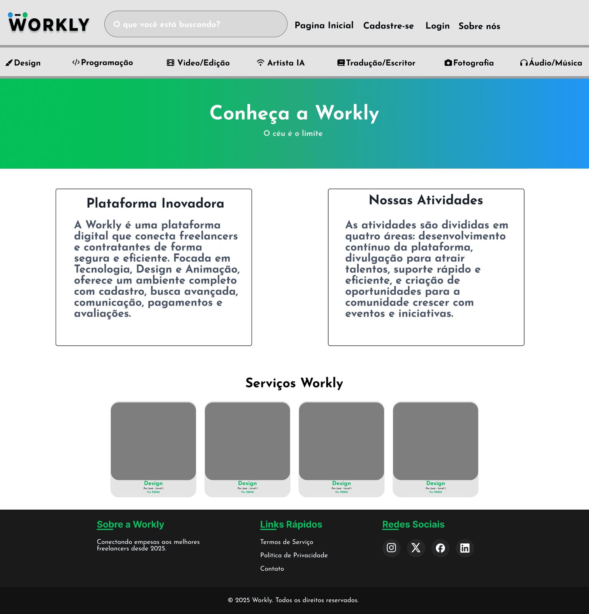

<div align="center" id="inicio">

# 
### Plataforma digital que conecta freelancers e contratantes de forma segura e eficiente.

***

### Centro Paula Souza
### Faculdade de Tecnologia de Jahu
### Curso de Tecnologia em Desenvolvimento de Software Multiplataforma

### Documento da aplicação web

### **Workly**

### Jaú, SP

### 2º Semestre/2026

***
</div>

<br>

<p align="left" style="font-size:28px;"><strong><em>Documentação do PI</em></strong></p>

<details open>
<summary><strong>📑 Sumário</strong></summary>

<br>

1. [Introdução](#introducao)
   - [Objetivos](#objetivos)
   - [Metodologia](#metodologia)
2. [Requisitos](#requisitos)
   - [Requisitos funcionais](#rf)
   - [Requisitos não funcionais](#rnf)
3. [Modelo de casos de uso](#casos-de-uso)
4. [Modelo do banco de dados](#modelo-do-banco)
5. [Banco de dados](#banco-de-dados)
6. [Diagrama de classes](#diagrama-de-classes)
7. [Estudo de viabilidade](#viabilidade)
8. [Regras de negócio (Modelo canvas)](#canvas)
9. [Design](#design)
10. [Protótipo](#prototipo)
11. [Aplicação](#aplicacao)
12. [Considerações finais](#consideracoes)
13. [Referências](#referencias)

</details>

<a id="introducao"></a>

# 1. Introdução

### 💡 Contextualização

O mercado de trabalho brasileiro passa por uma **significativa transformação**, com crescimento notável tanto nas demissões voluntárias quanto no interesse por áreas de tecnologia. Esses movimentos revelam uma busca por novos modelos de trabalho que ofereçam maior autonomia e flexibilidade.

A **Workly** nasce da crescente insatisfação das pessoas com as condições tradicionais do mercado de trabalho, oferecendo uma alternativa mais **justa, flexível e alinhada às demandas do futuro**. A plataforma conecta talentos criativos e digitais a oportunidades reais, permitindo que cada profissional atue com autonomia, segurança e valorização do seu portfólio.

### 🧩 Justificativa

As dores identificadas nos dois lados do mercado justificam a plataforma:

| Público | Dores identificadas |
|---------|---------------------|
| **Freelancers** | Insegurança no recebimento dos valores do projeto, comissões excessivas praticadas pelo mercado e dificuldade na divulgação do portfólio. |
| **Contratantes e empresas** | Dificuldade em triar profissionais qualificados, falta de garantias quanto aos prazos de entrega e ausência de canais centralizados de comunicação e contrato. |

Ao intermediar de forma transparente a relação entre contratantes e freelancers, a Workly transforma a frustração com o modelo convencional em oportunidades de crescimento, inovação e realização profissional.

<a id="objetivos"></a>

## • Objetivos

A Workly se posiciona como uma **plataforma integradora** que conecta freelancers qualificados a oportunidades de projetos flexíveis. O objetivo é desenvolver e consolidar uma plataforma digital que:

- ✨ Facilite conexões significativas entre profissionais independentes e contratantes da área de tecnologia e criação;
- 🔒 Ofereça segurança, eficiência e ferramentas adequadas para ambos os lados (contrato, negociação, chat e avaliações);
- 📈 Amplie as possibilidades de carreira e crescimento profissional;
- 🌍 Transforme o mercado de trabalho em algo mais justo e flexível.

<a id="metodologia"></a>

## • Metodologia

**Como?** O desenvolvimento é feito em equipe, com versionamento no GitHub, reuniões semanais e acompanhamento das tarefas em quadro no Trello. A aplicação é separada em **front-end** (SPA) e **back-end** (API REST), executados em contêineres e validados por testes automatizados e por uma esteira de integração contínua.

**Com o quê?**

| Camada | Tecnologia |
|--------|------------|
| Front-end | React 19, Vite e Tailwind CSS 4 (SPA) |
| Back-end | Node.js 24 e Express 5 (API REST) |
| Banco de dados | MongoDB 8 com Mongoose (não relacional) |
| Segurança | JWT, cookie de sessão, bcrypt, `express-rate-limit` e validação de CPF |
| Infraestrutura | Docker e Docker Compose (nginx, API e banco) |
| Integração contínua | GitHub Actions |
| Organização | Trello, GitHub e Visual Studio Code |
| Design | Figma e Canva |

**Onde?** O código e a documentação ficam no GitHub. A aplicação roda localmente em contêineres (`docker compose`) ou em modo de desenvolvimento (Node.js).

**Quando?** O cronograma completo está no **[Trello do Projeto](https://trello.com/b/WpYWgrs3/pi-site-de-freelancer)**.

**Equipe:** José Antônio, Luiz Gabriel, Cauã de Moraes e Vitor Perasoli.

<p align="right"><a href="#inicio">↑ Voltar ao início</a></p>

---

<a id="requisitos"></a>

# 2. Requisitos

Um **Documento de Requisitos de Sistema (DRS)** descreve as funcionalidades e restrições do sistema e serve como guia para a equipe de desenvolvimento.

<a id="rf"></a>

## • Requisitos funcionais

Legenda da situação atual no código: ✅ implementado · 🟡 parcial · ⏳ planejado.

#### 👤 Cadastro, acesso e perfil

| # | Requisito | Situação |
|---|-----------|:--------:|
| **RF 1** | Cadastrar usuário com informações básicas (nome, e-mail, senha, CPF e tipo de conta) | ✅ |
| **RF 2** | Realizar login (e-mail e senha), logout e recuperação de senha | ✅ |
| **RF 3** | Permitir criação e edição de perfis de freelancers e contratantes (com perfil público) | ✅ |

#### 🔍 Busca e navegação

| # | Requisito | Situação |
|---|-----------|:--------:|
| **RF 4** | Visualizar trabalhos (serviços) públicos | ✅ |
| **RF 5** | Navegar por categorias (Design, Programação, Vídeo/Edição, IA, Tradução/Escritor, Fotografia e Áudio/Música) | ✅ |
| **RF 6** | Sistema de pesquisa por palavras-chave | ✅ |

#### 📦 Criação e contratação de projetos

| # | Requisito | Situação |
|---|-----------|:--------:|
| **RF 7** | Solicitação, criação e personalização de propostas (com proposta e contraproposta de valor) | ✅ |
| **RF 8** | Criar projetos para receberem propostas | 🟡 |
| **RF 9** | Bloquear propostas indesejadas (hoje é possível recusar a proposta) | 🟡 |
| **RF 10** | Visualizar status do contrato (pendente, proposta, em andamento, entregue, concluído, cancelado) | ✅ |

#### 💬 Comunicação e contratos

| # | Requisito | Situação |
|---|-----------|:--------:|
| **RF 11** | Comunicação direta via chat por contrato (hoje apenas texto) | 🟡 |
| **RF 12** | Notificações (central interna com 13 tipos de aviso; e-mail e WhatsApp planejados) | 🟡 |
| **RF 13** | Marcar projeto como entregue, com confirmação das duas partes e pedido de ajuste | ✅ |

#### 💳 Pagamentos, depósitos e saques

| # | Requisito | Situação |
|---|-----------|:--------:|
| **RF 14** | Visualizar saldo e solicitar saques | ⏳ |
| **RF 15** | Diferentes meios de saque e depósito (cartão, PIX etc.) | ⏳ |
| **RF 16** | Limites de saque em diferentes horários para segurança | ⏳ |
| **RF 17** | Visualizar histórico de transações | ⏳ |
| **RF 18** | Permitir pagamentos dos projetos conforme contrato | ⏳ |

#### ⭐ Avaliações e feedbacks

| # | Requisito | Situação |
|---|-----------|:--------:|
| **RF 19** | Avaliação e exibição pública com comentário e nota (do serviço e do freelancer) | ✅ |

#### 📄 Páginas importantes

| # | Requisito | Situação |
|---|-----------|:--------:|
| **RF 20** | Página "Sobre Nós" | ✅ |
| **RF 21** | "Como Funciona" (para freelancers e clientes), hoje como seção da página inicial | 🟡 |
| **RF 22** | Termos de serviço e política de privacidade (hoje apresentados no cadastro) | 🟡 |

> A situação de cada requisito foi levantada a partir do código atual do repositório e deve ser confirmada pela equipe antes da entrega.

<a id="rnf"></a>

## • Requisitos não funcionais

#### Requisitos de produto

| # | Requisito | Descrição |
|---|-----------|-----------|
| **RNF 1** | 🚀 Desempenho | Resposta rápida e carregamento otimizado (build de produção com Vite servido pelo nginx; índices no banco para as consultas mais usadas) |
| **RNF 2** | 🌐 Compatibilidade | Interface responsiva, funcionando em diferentes navegadores e dispositivos |
| **RNF 3** | 🙂 Usabilidade | Interface intuitiva, com tema claro e escuro |
| **RNF 4** | 🔒 Segurança | Senhas com hash (bcrypt), sessão por token JWT em cookie, middleware de autenticação, limite de tentativas de login e de recuperação de senha, validação de CPF e revogação de sessões |

#### Requisitos de organização

| # | Requisito | Descrição |
|---|-----------|-----------|
| **RNF 5** | 📋 Gestão | Tarefas acompanhadas no Trello, reuniões semanais e versionamento no GitHub |
| **RNF 6** | 🔧  Manutenibilidade | Código organizado em camadas (rotas, controllers, services e models) e documentação atualizada neste repositório |

#### Requisitos de confiabilidade

| # | Requisito | Descrição |
|---|-----------|-----------|
| **RNF 7** | 🧪 Testes | Testes automatizados do back-end e do front-end (`node --test`), executados em contêiner |
| **RNF 8** | 🔄 Disponibilidade e dados | Healthchecks nos contêineres, volumes persistentes (`mongo-data` e `uploads`), scripts de backup e restauração e índices únicos que impedem duplicidades (por exemplo, contrato ativo e avaliação por cliente e serviço) |

#### Requisito de implementação

| # | Requisito | Descrição |
|---|-----------|-----------|
| **RNF 9** | 🧰 Tecnologias | SPA em React + Vite + Tailwind, API em Express 5, banco MongoDB 8, execução com Docker Compose |

#### Requisito de padrões

| # | Requisito | Descrição |
|---|-----------|-----------|
| **RNF 10** | 📐 Padrões | API REST em JSON sob o prefixo `/api`, identidade visual padronizada por *design tokens* (Tailwind `@theme`) e fluxo de trabalho com integração contínua |

#### Requisitos de interoperabilidade

| # | Requisito | Descrição |
|---|-----------|-----------|
| **RNF 11** | 🔗 Integração | Front-end e API se comunicam por HTTP/JSON; o nginx encaminha `/api` para o back-end dentro da rede interna do Docker, sem expor a API ao exterior |
| **RNF 12** | 📈 Escalabilidade | Serviços independentes em contêineres, preparados para evolução futura para orquestração (Kubernetes) |

<p align="right"><a href="#inicio">↑ Voltar ao início</a></p>

---

<a id="casos-de-uso"></a>

# 3. Modelo de casos de uso

[](Imagens/Casos%20de%20uso.png)

**Clique na imagem para ampliar** 🔍

> O diagrama acima é da primeira versão e deve ser regenerado com os casos 08 a 11 abaixo.

### 👥 Atores do sistema

| Ator | Descrição |
|------|-----------|
| **👤 Cliente (Contratante)** | Usuário que contrata serviços. Busca freelancers, negocia, acompanha o contrato, conversa e avalia. |
| **💻 Freelancer** | Profissional que oferece serviços. Cadastra serviços, responde propostas, executa e entrega. |
| **🖥 Sistema** | Autenticação, armazenamento de dados, notificações e controle de sessões. |
| **🔑 Administrador** | Gerenciaria usuários, removeria serviços inapropriados e resolveria disputas (planejado). |

### 🎭 Principais casos de uso

<details>
<summary><strong>01 – Cadastrar usuário</strong></summary>

**Atores**: Cliente, Freelancer  
**Descrição**: Permite que novos usuários criem uma conta.

**Fluxo principal**:
1. Usuário acessa a tela de cadastro
2. Informa nome, e-mail, CPF, senha e tipo de conta (Freelancer ou Contratante)
3. Sistema valida as informações (incluindo o CPF)
4. Sistema armazena os dados e confirma o cadastro

**Fluxo alternativo**: se o e-mail ou o CPF já estiverem cadastrados, o sistema exibe mensagem de erro.  
**Pós-condição**: conta criada com sucesso ✅
</details>

<details>
<summary><strong>02 – Realizar login e recuperar senha</strong></summary>

**Atores**: Cliente, Freelancer  
**Descrição**: Usuário acessa o sistema com credenciais ou redefine a senha.

**Fluxo principal**:
1. Usuário informa e-mail e senha
2. Sistema valida as credenciais e cria a sessão (token em cookie)
3. Usuário é redirecionado ao painel

**Fluxos alternativos**:
- Credenciais inválidas → o sistema informa o erro e limita novas tentativas
- "Esqueci a senha" → o sistema gera um link de redefinição com prazo de validade
</details>

<details>
<summary><strong>03 – Criar serviço</strong></summary>

**Atores**: Freelancer  
**Descrição**: Freelancer cadastra um novo serviço.

**Fluxo principal**:
1. Freelancer acessa o editor de serviços
2. Informa nome, descrição, categoria, preço (fixo, negociável ou a combinar), extras e imagem
3. Sistema salva e exibe o serviço na listagem

**Pós-condição**: serviço disponível para visualização ✅
</details>

<details>
<summary><strong>04 – Buscar e visualizar serviços</strong></summary>

**Atores**: Cliente  
**Descrição**: Cliente pesquisa e visualiza serviços, por palavra-chave ou categoria.

**Fluxo principal**:
1. Cliente acessa a busca ou uma categoria
2. Informa termos (por exemplo, "edição de vídeo")
3. Sistema lista os serviços correspondentes
4. Cliente abre os detalhes e o perfil público do freelancer
</details>

<details>
<summary><strong>05 – Contratar e negociar serviço</strong></summary>

**Atores**: Cliente, Freelancer  
**Descrição**: Cliente solicita um serviço e as partes alinham o valor.

**Fluxo principal**:
1. Cliente escolhe o serviço e envia o pedido (detalhes, prazo desejado e referências)
2. Sistema cria o contrato como *pendente* e notifica o freelancer
3. Freelancer aceita ou recusa
4. Se o preço for negociável, as partes trocam proposta e contraproposta até aprovar o valor

**Pós-condição**: contrato criado entre as partes ✅  
**Regra**: não pode existir mais de um contrato ativo do mesmo cliente para o mesmo serviço.
</details>

<details>
<summary><strong>06 – Avaliar serviço</strong></summary>

**Atores**: Cliente  
**Descrição**: Após a conclusão do contrato, o cliente avalia o serviço e o freelancer.

**Fluxo principal**:
1. Cliente acessa seus contratos concluídos
2. Escolhe o contrato e informa nota do serviço, nota do freelancer e comentário
3. Sistema registra a avaliação e atualiza a média do freelancer

**Pós-condição**: avaliação exibida no perfil do freelancer ⭐
</details>

<details>
<summary><strong>07 – Gerenciar perfil</strong></summary>

**Atores**: Freelancer, Cliente  
**Descrição**: Permite alterar dados do perfil, trocar o tipo de conta, alterar a senha e excluir a conta.

**Fluxo principal**:
1. Usuário acessa a página de perfil
2. Altera informações (nome, bio, foto, links, portfólio e preferências)
3. Sistema salva as alterações
</details>

<details>
<summary><strong>08 – Acompanhar contrato (execução e entrega)</strong></summary>

**Atores**: Cliente, Freelancer  
**Descrição**: Controla o andamento do trabalho até a conclusão.

**Fluxo principal**:
1. Freelancer inicia o trabalho
2. Freelancer marca a entrega
3. Cliente confirma a entrega, e o contrato é concluído

**Fluxos alternativos**: o cliente solicita ajuste (o contrato volta para execução) ou qualquer parte cancela o contrato.
</details>

<details>
<summary><strong>09 – Conversar pelo contrato</strong></summary>

**Atores**: Cliente, Freelancer  
**Descrição**: Troca de mensagens de texto dentro do contrato, com controle de mensagens lidas e não lidas.
</details>

<details>
<summary><strong>10 – Receber notificações</strong></summary>

**Atores**: Cliente, Freelancer  
**Descrição**: O sistema avisa sobre novo contrato, proposta, entrega, cancelamento, avaliação e mensagem. O usuário pode marcar como lida, marcar todas ou excluir.
</details>

<details>
<summary><strong>11 – Favoritar serviço</strong></summary>

**Atores**: Cliente  
**Descrição**: Salva serviços de interesse e os consulta na página de favoritos.
</details>

<p align="right"><a href="#inicio">↑ Voltar ao início</a></p>

---

<a id="modelo-do-banco"></a>

# 4. Modelo do banco de dados

O banco é **não relacional (MongoDB)**. Os modelos abaixo seguem a sequência conceitual → lógico → físico.

### 🧠 Modelo conceitual

[](Imagens/er-conceitual.png)
**Clique na imagem para ampliar** 🔍

> Código-fonte editável do diagrama (Mermaid): [Imagens/diagramas/er-conceitual.mmd](Imagens/er-conceitual.mmd)

O **contrato** é o centro do modelo: liga cliente, freelancer e serviço e é a origem das mensagens, avaliações e notificações.

### 📐 Modelo lógico

No MongoDB, os relacionamentos são feitos por **referência** (`ObjectId`). Os dados que só fazem sentido dentro de um contrato ficam **embutidos** nele (o histórico de negociação).

[](Imagens/er-logico.png)
**Clique na imagem para ampliar** 🔍

> Código-fonte editável do diagrama (Mermaid): [Imagens/diagramas/er-logico.mmd](Imagens/er-logico.mmd)

**Valores de domínio**

| Campo | Valores |
|-------|---------|
| `Contrato.status` | `pendente`, `proposta_pendente`, `proposta_aceita`, `em_andamento`, `entregue`, `concluido`, `cancelado`, `encerrado` |
| `Contrato.historico[].tipo` | `proposta`, `contraproposta`, `aceite`, `entrega`, `ajuste_solicitado` |
| `Contrato.negociacao.estado` | `aguardando_freelancer`, `aguardando_cliente`, `fechado` |
| `Notificacao.tipo` | 13 tipos: `contrato_novo`, `proposta_nova`, `proposta_aceita`, `proposta_recusada`, `proposta_valor`, `valor_aprovado`, `ajuste_solicitado`, `trabalho_iniciado`, `entrega_realizada`, `entrega_confirmada`, `contrato_cancelado`, `avaliacao_recebida`, `mensagem_nova` |

### 💾 Modelo físico

| Item | Definição |
|------|-----------|
| SGBD | MongoDB 8 (imagem `mongo:8.0`) |
| Banco | `workly` |
| Acesso | Mongoose 8 (ODM) |
| Coleções | `usuarios`, `categorias`, `servicos`, `contratos`, `mensagens`, `avaliacoes`, `favoritos`, `notificacoes`, `sessoes_revogadas` |
| Campos automáticos | `createdAt` e `updatedAt` (timestamps do Mongoose) em todas as coleções, exceto `sessoes_revogadas` |

**Índices**

| Coleção | Índice | Finalidade |
|---------|--------|------------|
| `usuarios` | `email` e `cpf` únicos | Impedir contas duplicadas |
| `usuarios` | `{ tipoConta, localizacao }`, `{ tipoConta, disponibilidade }`, `{ avaliacaoMedia, totalAvaliacoes }` | Busca e ordenação de freelancers |
| `categorias` | `legacyId` e `slug` únicos | Identificação estável das categorias |
| `servicos` | `{ categoria, createdAt }`, `{ freelancer, createdAt }`, `{ preco, createdAt }` | Listagem por categoria, por freelancer e por preço |
| `servicos` | Índice de texto em `nome`, `descricao` e `extra` | Pesquisa por palavra-chave |
| `contratos` | Único parcial `{ cliente, servico }` para status ativos | Um único contrato ativo por cliente e serviço |
| `contratos` | `{ freelancer, status, createdAt }`, `{ cliente, createdAt }`, `{ servico, status, createdAt }` | Painéis de contratos |
| `mensagens` | `{ contrato, createdAt }`, `{ contrato, remetente, lida }` | Histórico do chat e não lidas |
| `avaliacoes` | `{ autor, contrato }` único e `{ autor, servico }` único parcial | Uma avaliação por contrato e por serviço |
| `favoritos` | `{ usuario, servico }` único | Evitar favorito repetido |
| `notificacoes` | `{ destinatario, lida, createdAt }` | Central de notificações |
| `sessoes_revogadas` | `expiraEm` com TTL (`expireAfterSeconds: 0`) | Remove sozinha as sessões revogadas que já expiraram |

> Imagem da primeira versão do DER (modelo relacional): [Imagens/WorklyDER.png](Imagens/WorklyDER.png). Ela foi substituída pelos modelos acima.

<p align="right"><a href="#inicio">↑ Voltar ao início</a></p>

---

<a id="banco-de-dados"></a>

# 5. Banco de dados

### 🚀 Criação e carga inicial

- O MongoDB sobe no contêiner `db`, com volume persistente `mongo-data`.
- O script `init.js` roda apenas quando o volume está vazio e cria a categoria inicial no banco `workly`.
- Ao conectar, a API garante as **7 categorias padrão**:

| legacyId | Nome | Slug |
|:--------:|------|------|
| 1 | Design | `design` |
| 2 | Programação | `programacao` |
| 3 | Vídeo/Edição | `video-edicao` |
| 4 | Inteligência Artificial | `inteligencia-artificial` |
| 5 | Tradução/Escritor | `traducao-escritor` |
| 6 | Fotografia | `fotografia` |
| 7 | Áudio/Música | `audio-musica` |

- Com `AUTO_SEED=true`, a aplicação cria serviços de demonstração (nomeados "Demo Workly - ..."). Por padrão, `AUTO_SEED=false`.

### 🔁 Operações (CRUD) por coleção

| Coleção | Criar | Ler | Atualizar | Excluir |
|---------|-------|-----|-----------|---------|
| `usuarios` | `POST /api/auth/cadastro` | `GET /api/usuarios/perfil`, `GET /api/usuarios/publico/:id` | `PUT /api/usuarios/perfil`, `PATCH /api/usuarios/tipo-conta`, `PUT /api/usuarios/perfil/senha` | `DELETE /api/usuarios/perfil` (exclusão lógica) |
| `servicos` | `POST /api/servicos` | `GET /api/servicos`, `GET /api/servicos/:id`, `GET /api/servicos/categoria/:id` | — | `DELETE /api/servicos/:id` (exclusão lógica) |
| `contratos` | `POST /api/contratos` | `GET /api/contratos/meus` | `POST /api/contratos/:id/aceitar`, `recusar`, `iniciar`, `entregar`, `confirmar`, `solicitar-ajuste`, `propor-valor`, `aprovar-valor`, `cancelar` | — |
| `mensagens` | `POST /api/mensagens` | `GET /api/mensagens/contrato/:contratoId`, `/nao-lidas`, `/resumo` | — | — |
| `avaliacoes` | `POST /api/avaliacoes` | `GET /api/avaliacoes/minhas`, `GET /api/avaliacoes/servico/:servicoId` | — | — |
| `favoritos` | `POST /api/favoritos` | `GET /api/favoritos` | — | `DELETE /api/favoritos/servico/:servicoId` |
| `notificacoes` | Gerada pelo sistema | `GET /api/notificacoes`, `/nao-lidas` | `PATCH /api/notificacoes/:id/lida`, `/todas-lidas` | `DELETE /api/notificacoes/:id` |

### 🔐 Integridade, backup e restauração

- **Exclusão lógica:** usuários e serviços usam `removido`, `removidoEm` e `removendoDesde`. Existe o script `recuperarExclusoes.js`.
- **Concorrência:** o índice único parcial impede dois contratos ativos do mesmo cliente para o mesmo serviço, mesmo com requisições simultâneas.
- **Backup e restauração:** `npm run backup` e `npm run restore` na pasta `backend` (scripts `backup.js` e `restore.js`).
- **Índices:** o script `indices.js` e a rotina de inicialização garantem a criação dos índices.
- **Persistência:** o teste `test-docker-persistence.mjs` confirma que os dados sobrevivem a reinicializações dos contêineres.

<p align="right"><a href="#inicio">↑ Voltar ao início</a></p>

---

<a id="diagrama-de-classes"></a>

# 6. Diagrama de classes

O diagrama representa os modelos da aplicação (classes Mongoose). Os métodos correspondem às ações expostas pela API.

[](Imagens/diagrama-classes.png)
**Clique na imagem para ampliar** 🔍

> Código-fonte editável do diagrama (Mermaid): [Imagens/diagramas/diagrama-classes.mmd](Imagens/diagrama-classes.mmd)

> Diagrama da primeira versão: [Imagens/Workly.vpd.png](Imagens/Workly.vpd.png).

<p align="right"><a href="#inicio">↑ Voltar ao início</a></p>

---

<a id="viabilidade"></a>

# 7. Estudo de viabilidade

### 📈 Mercado

O mercado de plataformas para freelancers no Brasil está em constante expansão, impulsionado pela crescente demanda por trabalho remoto e pela valorização de profissionais autônomos, especialmente nas áreas de tecnologia e design. Embora existam diversos sites semelhantes, a Workly se diferencia por oferecer uma experiência mais ampla e personalizada, com foco em capacitação e oportunidades voltadas para o público jovem e para empresas que buscam inovação.

### 💵 Financeiro

Será cobrado 10% do valor pago pela contratação do freelancer, sobre o preço do serviço. Anúncios e um plano premium também serão formas de receita. Os gastos previstos são hospedagem e anúncios de divulgação. A cobrança depende dos requisitos de pagamento (RF 14 a RF 18), ainda planejados.

### 🔧 Técnica

O projeto é desenvolvido com ferramentas gratuitas: Visual Studio Code, Figma, Trello, GitHub e Docker. Toda a aplicação sobe com um único comando (`docker compose`), o que torna a instalação igual em qualquer computador da equipe. O código é testado automaticamente pelo GitHub Actions a cada alteração. Para a publicação, é possível começar com um servidor simples com Docker e, conforme a plataforma crescer, migrar para nuvem (AWS ou DigitalOcean) e orquestração com Kubernetes.

### 🏢 Operacional

A organização é capaz de executar o projeto com 4 pessoas, divididas em funções como front-end, back-end, design e gestão. A comunicação ocorre em reuniões semanais, com Trello para as tarefas e GitHub para o controle de versão.

<p align="right"><a href="#inicio">↑ Voltar ao início</a></p>

---

<a id="canvas"></a>

# 8. Regras de negócio (Modelo canvas)

[](Imagens/Modelo%20de%20Negocios%20Canvas%20WORKLY.png)

### 🎯 O que será elaborado

A Workly é uma plataforma digital que conecta freelancers e contratantes de forma segura e eficiente, com cadastro, busca, contratação com negociação de valor, chat integrado, notificações e avaliações, em áreas como Tecnologia, Design, Vídeo, Fotografia, Áudio e Tradução.

### 🔨 Como será elaborado

- **Parcerias principais:** empresas de pagamentos digitais, serviços de comunicação e instituições de ensino.
- **Atividades principais:** desenvolvimento e melhoria contínua da plataforma, divulgação, suporte e eventos para a comunidade.
- **Recursos principais:** equipe dedicada, tecnologia de qualidade, sistema seguro de pagamento e banco de dados com perfis verificados.

### 👥 Para quem será elaborado

- **Segmento de mercado:** freelancers (desenvolvedores, designers, animadores, analistas de dados e marketing) e contratantes (startups, empreendedores e empresas que buscam soluções ágeis).
- **Relacionamento com clientes:** suporte, materiais de autoatendimento, eventos e coleta de feedback.
- **Canais:** o site da plataforma, redes sociais e parcerias com faculdades e empresas.

### 💰 Quanto custará

| Custo | Descrição |
|-------|-----------|
| **Desenvolvimento** | Sem custo: o projeto é acadêmico e desenvolvido pela própria equipe. |
| **Infraestrutura** | Serviços gratuitos no início. Domínio e certificado SSL entre R$ 10,00 e R$ 100,00 por ano (estimativa de pior caso: R$ 100,00). |
| **Legais e administrativas** | Não consideradas, pois a plataforma é um objeto de estudo acadêmico. |
| **Marketing** | Divulgação orgânica no início, com possibilidade de tráfego pago conforme a receita. |

<p align="right"><a href="#inicio">↑ Voltar ao início</a></p>

---

<a id="design"></a>

# 9. Design

### 🎨 Paleta de cores

A paleta transmite profissionalismo, confiança e modernidade, com o verde como cor da marca. No código, as cores são definidas como *design tokens* do Tailwind (`frontend/src/styles.css`), com versões para tema claro e escuro.

| Amostra | Uso | Token | Código |
|:-------:|-----|-------|--------|
|  | Primária | `workly-primary` | `#04BF55` |
|  | Primária escura | `workly-primary-dark` | `#039447` |
|  | Destaque (glow) | `workly-primary-glow` | `#0FCE6A` |
|  | Texto/links sobre claro | `workly-primary-ink` | `#037A3A` |
|  | Verde profundo | `workly-deep` | `#05452A` |
|  | Fundo claro | `workly-background` | `#F5F3EE` |
|  | Superfície alternativa | `workly-surface-muted` | `#EFECE5` |
|  | Borda | `workly-border` | `#DDD8CC` |
|  | Texto | `workly-text` | `#16211B` |
|  | Texto secundário | `workly-text-muted` | `#5E6862` |
|  | Fundo escuro | `workly-dark-background` | `#0C1411` |
|  | Superfície escura | `workly-dark-surface` | `#131D19` |
|  | Texto no escuro | `workly-dark-text` | `#ECEBE5` |
|  | Destaque no escuro | `workly-dark-accent` | `#4ADE80` |

### 🔤 Tipografia

| Fonte | Uso |
|-------|-----|
| **Poppins** | Fonte principal da interface e do corpo de texto |
| **Bricolage Grotesque** | Títulos de destaque (fonte *display*), com Poppins como alternativa |
| **Montserrat** | Logotipo da marca |

As fontes são carregadas localmente pela aplicação (arquivos em `/vendor`), sem depender de servidores externos.

### 🔖 Logo

O logotipo da Workly é um **isotipo** que utiliza vetores e a fonte Montserrat. Simboliza a **conexão eficiente e profissional** entre freelancers e clientes, com dois pontos (azul e verde) ligados por uma seta, que representam as duas partes da plataforma.

### 📱 Wireframes

Os wireframes e as telas de alta fidelidade estão no protótipo do Figma (seção 10).

### 🧭 Modelo de navegação

[](Imagens/Modelo%20de%20navegacao.png)
**Clique na imagem para ampliar** 🔍

Páginas existentes na aplicação atual:

| Grupo | Páginas |
|-------|---------|
| Públicas | Início, Sobre, Todos os serviços, Categoria, Detalhe do serviço, Perfil público |
| Acesso | Login, Cadastro, Redefinição de senha |
| Contratação | Contratar, Proposta, Contratos, Chat do contrato |
| Conta | Perfil, Editor de serviço, Favoritos, Mensagens |
| Sistema | Página não encontrada (404) |

<p align="right"><a href="#inicio">↑ Voltar ao início</a></p>

---

<a id="prototipo"></a>

# 10. Protótipo

O protótipo da Workly foi desenvolvido no **Figma**, que permite criar interfaces interativas e visualmente atraentes.

> 🔗 **[Acesse o protótipo no Figma](https://www.figma.com/design/hYmRgDqf9kCFHGjJNyExRh/Prot%C3%B3tipo-P.I?node-id=0-1&t=5eQE3HyoxGAMwKo0-0)**

---

<a id="aplicacao"></a>

# 11. Aplicação

A primeira versão foi uma página estática. A versão atual é uma **aplicação web completa** (SPA em React + API em Express + MongoDB), executada em contêineres Docker.

[](Imagens/paginainicial.png)
**Clique na imagem para ampliar** 🔍

### 🧱 Arquitetura

| Contêiner | Função |
|-----------|--------|
| `web` | nginx servindo o React compilado e encaminhando `/api` para o back-end (porta `8080` no computador) |
| `backend` | API Express 5 em Node.js 24, sem porta publicada: só a rede interna do Docker a acessa |
| `db` | MongoDB 8 com volume persistente |

Os Dockerfiles usam *multi-stage build* (dependências, testes e execução enxuta) e têm *healthcheck*. Os volumes `mongo-data` e `uploads` guardam o banco e as imagens enviadas.

### 🐳 Como rodar com Docker (recomendado)

Pré-requisito: Docker com Docker Compose.

```bash
# 1. Gera o .env com senha do banco e JWT aleatórios (preserva um .env existente)
node scripts/setup-docker.cjs

# 2. Sobe os três contêineres e espera ficarem saudáveis
docker compose up --build -d --wait
```

Abra **http://localhost:8080**.

### 💻 Como rodar em desenvolvimento

É necessário ter **Node.js 24, npm e MongoDB** instalados, com o MongoDB em execução.

**1. Back-end** (pasta `backend`): copie `.env.example` para `.env`, configure `MONGO_URI` e preencha `JWT_SECRET` com uma chave longa e aleatória. Mantenha `AUTO_SEED=false` para iniciar sem dados de demonstração.

```bash
cd backend
npm ci
npm run prepare:assets
npm run dev
```

A API fica em `http://localhost:3000`.

**2. Front-end** (pasta `frontend`): copie `.env.example` para `.env.local`.

```bash
cd frontend
npm ci
npm run dev
```

Abra **http://localhost:5173**.

### ✅ Testes e integração contínua

- `npm test` em `backend` e em `frontend` (21 arquivos de teste no back-end e 20 no front-end).
- No Docker: `docker compose --profile test run --rm backend-test` e `frontend-test`.
- O **GitHub Actions** valida a configuração, constrói as imagens, roda os testes, sobe os contêineres com espera de saúde, testa a persistência dos dados e executa um *smoke test*.

<p align="right"><a href="#inicio">↑ Voltar ao início</a></p>

---

<a id="consideracoes"></a>

# 12. Considerações finais

### 1º Semestre
Este documento detalhou o processo de desenvolvimento da aplicação Workly. Durante o percurso, enfrentamos desafios, como a perda de um membro da equipe responsável pela documentação. No entanto, com a dedicação da equipe remanescente, conseguimos iniciar e avançar em diversas frentes, que serão concluídas no próximo semestre. Acreditamos que a Workly trará contribuições significativas para o mercado de trabalho, conectando freelancers e contratantes de forma eficiente e segura.

### 2º Semestre
Atualizamos toda a documentação e continuamos aprimorando a plataforma. Tivemos dificuldade em concluir o desenvolvimento para atender aos requisitos do semestre, mas avançamos em diversos aspectos, como o design, o protótipo e a documentação.

### Versão atual
A aplicação evoluiu de uma página estática para uma plataforma com front-end em React, API em Express e banco MongoDB, executada em Docker e validada por testes automatizados e por integração contínua. Estão implementados cadastro e acesso seguro, serviços, contratos com negociação de valor, chat, notificações, favoritos e avaliações.

**Próximos passos:** módulo de pagamentos, depósitos e saques (RF 14 a RF 18), notificações por e-mail e WhatsApp, envio de imagens e documentos no chat, página de Termos e Privacidade, perfil de administrador e orquestração com Kubernetes.

<p align="right"><a href="#inicio">↑ Voltar ao início</a></p>

---

<a id="referencias"></a>

# 13. Referências

- Centro Paula Souza. *Manual de Projetos Interdisciplinares para o CST em Desenvolvimento de Software Multiplataforma*, versão 1.0.0, 2021.
- Template de documentação da Fatec Jahu: <https://github.com/FatecJahu/template>
- React: <https://react.dev>
- Vite: <https://vite.dev>
- Tailwind CSS: <https://tailwindcss.com>
- Express: <https://expressjs.com>
- Mongoose: <https://mongoosejs.com>
- MongoDB: <https://www.mongodb.com/docs/>
- Docker: <https://docs.docker.com>
- GitHub Actions: <https://docs.github.com/actions>
- Mermaid (diagramas deste documento): <https://mermaid.js.org>
- Figma: <https://www.figma.com>
- Trello do projeto: <https://trello.com/b/WpYWgrs3/pi-site-de-freelancer>

<p align="right"><a href="#inicio">↑ Voltar ao início</a></p>
